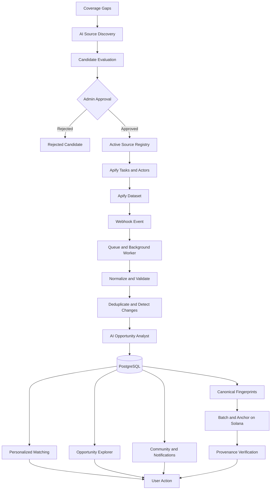
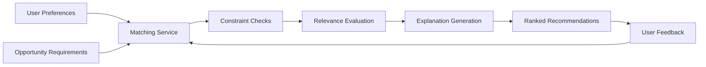

flowchart TD
    A["Receive source event"] --> B["Validate and persist event"]
    B --> C{"Duplicate event?"}
    C -- Yes --> D["Record duplicate delivery; do not repeat action"]
    C -- No --> E["Resolve active synchronization rules"]
    E --> F{"Authorized and eligible?"}
    F -- No --> G["Record skipped or blocked outcome"]
    F -- Yes --> H["Resolve destination mappings"]
    H --> I["Calculate and validate destination quantities"]
    I --> J{"All required checks pass?"}
    J -- No --> K["Block affected destination and report reason"]
    J -- Yes --> L["Create durable destination operations"]
    L --> M["Dispatch independently"]
    M --> N{"Exchange outcome"}
    N -- Confirmed --> O["Track order and fills"]
    N -- Rejected --> P["Record failure; assess recovery"]
    N -- Unknown --> Q["Reconcile before any retry"]
    P --> R["Update group status"]
    O --> S["Reconcile destination state"]
    Q --> S
    S --> R
    G --> R
    K --> R


# Scout — The Global Opportunity Intelligence Network

> **Discover. Understand. Match. Verify. Act. Build Your Reputation.**

Scout is a global opportunity intelligence platform designed to help people discover, understand, evaluate, and act on opportunities from across the internet. It combines AI-powered source discovery, automated data collection through Apify, personalized opportunity intelligence, community collaboration, and a Solana-powered provenance layer to transform fragmented information into actionable opportunities.

Scout is designed for students, developers, researchers, founders, freelancers, organizations, and anyone looking for opportunities to learn, build, collaborate, secure funding, or advance their work.

**The vision:** Make the world's opportunities easier to discover, understand, access, and act upon.

---

## Table of Contents

- [1. Overview](#1-overview)
- [2. The Problem](#2-the-problem)
- [3. Our Solution](#3-our-solution)
- [4. Core Principles](#4-core-principles)
- [5. Key Features](#5-key-features)
- [6. How Scout Works](#6-how-scout-works)
- [7. System Architecture](#7-system-architecture)
- [8. AI Intelligence Layer](#8-ai-intelligence-layer)
- [9. Apify Data Collection Engine](#9-apify-data-collection-engine)
- [10. Solana Integration and Data Provenance](#10-solana-integration-and-data-provenance)
- [11. Opportunity Matching Engine](#11-opportunity-matching-engine)
- [12. Community and Collaboration](#12-community-and-collaboration)
- [13. Scout Passport and Reputation](#13-scout-passport-and-reputation)
- [14. User Roles and Permissions](#14-user-roles-and-permissions)
- [15. Data Model](#15-data-model)
- [16. API Design](#16-api-design)
- [17. Security and Privacy](#17-security-and-privacy)
- [18. Technology Overview](#18-technology-overview)
- [19. Getting Started](#19-getting-started)
- [20. Environment Configuration](#20-environment-configuration)
- [21. Development Workflow](#21-development-workflow)
- [22. Testing and Quality Assurance](#22-testing-and-quality-assurance)
- [23. Deployment and Operations](#23-deployment-and-operations)
- [24. Limitations and Trust Model](#24-limitations-and-trust-model)
- [25. Roadmap](#25-roadmap)
- [26. Contributing](#26-contributing)
- [27. License](#27-license)
- [28. Acknowledgements](#28-acknowledgements)

---

## 1. Overview

Finding an opportunity is only the beginning. People also need to understand its requirements, determine whether it fits their goals, identify the next steps, and sometimes find collaborators who can help them complete it.

Scout brings these activities into a connected ecosystem.

Instead of treating opportunities as isolated listings, Scout treats them as structured, continuously monitored information that can be analyzed, personalized, discussed, and linked to evidence of its origin.

The platform follows a continuous intelligence loop:

**Discover → Understand → Match → Verify → Act → Complete → Build Reputation**

### What makes Scout different?

Traditional discovery platforms generally focus on listing opportunities. Scout aims to connect the entire journey:

- **Discovery:** Identify potential opportunity sources across countries, industries, and communities.
- **Collection:** Automatically collect information from approved sources.
- **Intelligence:** Structure, classify, summarize, and analyze opportunity requirements.
- **Personalization:** Help users identify opportunities aligned with their skills, interests, and goals.
- **Provenance:** Preserve information about where a record came from and whether its fingerprint has been anchored on Solana.
- **Participation:** Enable discussions, groups, collaboration, and community engagement.
- **Reputation:** Support evidence-based records of participation and achievement.

Scout is not intended to replace original opportunity providers. It helps people discover and understand opportunities while preserving links to their original sources.

## 2. The Problem

### 2.1 Fragmented information

Opportunities are distributed across thousands of websites, university portals, company career pages, research institutions, grant providers, developer communities, hackathon platforms, and other independent sources.

There is no single place where people can reliably discover everything relevant to their goals.

### 2.2 Time-consuming manual searches

People repeatedly search the same websites, compare listings manually, copy information between tools, and revisit pages to check whether deadlines or requirements have changed.

This process consumes time that could be spent learning, building, applying, and collaborating.

### 2.3 Unclear requirements and eligibility

An opportunity may look attractive but contain complex eligibility conditions, application requirements, location restrictions, documentation requirements, or deadlines.

Users need more than a title and a short description. They need a clearer understanding of what the opportunity requires and what they should do next.

### 2.4 Missed updates and deadlines

Opportunities can close, change their requirements, extend deadlines, or become unavailable. A listing that was useful yesterday may no longer be actionable today.

Without monitoring and change detection, users may rely on outdated information.

### 2.5 Limited personalization

A large collection of opportunities does not automatically help a person identify the most relevant ones.

Students, developers, researchers, and founders have different skills, interests, experience levels, goals, and eligibility constraints. Generic discovery systems often make users perform this matching themselves.

### 2.6 Trust and provenance challenges

A listing may be copied from another website, modified, or presented without enough context about its origin.

Users need to distinguish the information Scout has collected and checked from claims made by an external provider. They also need a way to inspect the provenance of a particular record.

### 2.7 Discovery without collaboration

Finding an opportunity does not guarantee that someone has the community, collaborators, knowledge, or support needed to pursue it.

Opportunity discovery, collaboration, and evidence of achievement are often spread across disconnected platforms.

### The underlying problem

The challenge is not simply that information is difficult to find. It is that the journey from finding information to taking meaningful action is fragmented.

Scout is designed to connect that journey.

---

## 3. Our Solution

Scout introduces an opportunity intelligence layer between the internet's many opportunity sources and the people who need them.

The platform identifies relevant sources, collects information from approved sources, transforms raw records into structured opportunities, applies AI-assisted analysis, and helps users discover opportunities that match their goals.

A provenance layer records source relationships and supports cryptographic fingerprints and optional on-chain anchoring. Community features connect people around shared interests and opportunities.

### The solution in practice

| Problem | Scout's approach |
|---|---|
| Information is scattered | A centralized discovery experience across multiple source categories |
| Manual collection is repetitive | Scheduled collection and monitoring through Apify |
| Listings have inconsistent formats | Normalization into a common opportunity data model |
| Requirements are difficult to understand | AI-assisted summaries and requirement analysis |
| Users struggle to find relevant opportunities | Profile-aware matching and filtering |
| Information may become outdated | Source monitoring and record change detection |
| Origin and record integrity are unclear | Source provenance, cryptographic fingerprints, and optional Solana anchoring |
| People lack collaboration opportunities | Community posts, groups, discussions, and connection recommendations |
| Achievements are spread across platforms | A vision for evidence-based reputation and a Scout Passport |

Scout's goal is to make opportunity discovery more intelligent, transparent, and actionable—not to promise that every opportunity is legitimate, every match is eligible, or every application will succeed.

## 4. Core Principles

### 4.1 Intelligence before volume

More listings are not automatically better. Scout should prioritize useful, relevant, structured information over the raw number of records collected.

### 4.2 Human oversight for source activation

AI can recommend potential sources, but source candidates should pass administrative review before entering the active collection registry.

### 4.3 Original sources remain authoritative

Scout provides discovery and analysis. The original provider remains the authority on official requirements, eligibility decisions, deadlines, and application outcomes.

### 4.4 Provenance is not the same as legitimacy

A fingerprint can help detect changes to a record. An on-chain transaction can demonstrate that a particular commitment was recorded. Neither independently proves that the original website or opportunity is legitimate.

### 4.5 Privacy by design

Public opportunity information should be separated from private user information, applications, contact details, and sensitive documents.

### 4.6 Evidence-based reputation

Reputation should be grounded in attributable activity and verifiable evidence, not fabricated engagement, arbitrary rewards, or unsupported claims.

### 4.7 Global by design

Scout is intended to support opportunities from different countries, regions, industries, and languages, subject to source availability, access rules, and data quality.

---

## 5. Key Features

The following describes Scout's intended product capabilities. The status of individual features depends on their implementation in the current repository.

### 5.1 Global Opportunity Explorer

A central discovery interface for browsing opportunities across multiple categories.

Potential categories include:

- Jobs and internships
- Grants and funding
- Scholarships and fellowships
- Hackathons and developer competitions
- Bounties and builder programs
- Research opportunities
- Startup and accelerator programs
- Open-source projects
- Procurement and calls for proposals
- Training programs and educational opportunities
- Events and collaboration opportunities

Users can explore listings, inspect details, filter results, review deadlines, and follow the original provider's link.

### 5.2 AI Source Discovery

An AI-assisted administration workflow for expanding Scout's source coverage.

The system can be designed to:

1. Identify gaps in existing source coverage.
2. Discover candidate websites and opportunity portals.
3. Classify each candidate by country, region, category, and source type.
4. Extract source metadata and the candidate's canonical URL.
5. assess relevance and confidence.
6. Identify potential duplicates and suspicious inconsistencies.
7. Recommend an appropriate collection adapter or Apify Actor.
8. Present the candidate for administrative review.

AI Source Discovery finds **potential sources**, not a guaranteed complete set of opportunities.

A candidate should not become active merely because an AI model recommends it.

### 5.3 Administrative Source Registry

A central registry of approved sources and their collection settings.

Each source can be associated with:

- Canonical URL and display name
- Country or geographic coverage
- Opportunity categories
- Source type
- Collection adapter or Actor configuration
- Approval and operational status
- Crawl frequency
- Last successful run
- Last observed content
- Failure history and health information

The registry gives administrators control over what Scout collects and how often it runs.

### 5.4 Automated Collection with Apify

Apify is responsible for collecting opportunity data from approved sources using configured Actors and Tasks.

The collection pipeline is designed to support:

- Scheduled source crawling
- Structured dataset output
- Source-specific extraction logic
- Webhook-triggered ingestion
- Retry handling and failure tracking
- Deduplication and change detection
- Operational monitoring

Apify handles collection; Scout's processing layer handles the transformation of collected data into the platform's canonical opportunity records.

### 5.5 AI Opportunity Analyst

An AI-assisted analysis experience for individual opportunity records.

Depending on the available data and implemented model, it can help users understand:

- Opportunity summaries
- Eligibility requirements
- Required skills and experience
- Application materials
- Deadlines and important dates
- Geographic and other restrictions
- Suggested preparation steps
- Potential gaps between a user's profile and stated requirements

AI analysis should distinguish explicitly stated facts from inferred observations. Unknown requirements should be marked as unknown rather than invented.

AI-generated guidance is informational and should not be treated as an official eligibility decision.

### 5.6 Personalized Opportunity Matching

Scout can compare opportunity requirements with a user's authorized profile information.

Matching signals may include:

- Skills
- Interests
- Education and experience
- Career or project goals
- Opportunity category
- Geographic preferences
- Stated eligibility constraints
- Application deadline and availability

A match score is a relevance estimate, not a guarantee of eligibility, selection, funding, or employment.

### 5.7 Opportunity Monitoring

Monitoring helps detect when a source or listing changes.

Useful events include:

- Newly discovered opportunities
- Changed deadlines
- Updated descriptions or eligibility criteria
- Removed or unavailable listings
- Repeated source failures
- Duplicate records
- Opportunities approaching their deadlines

Where implemented, these events can support notifications and a historical change log.

### 5.8 Source Provenance and Solana Anchoring

Scout maintains relationships between opportunity records and their source information.

A provenance record can contain a normalized record fingerprint, a version identifier, a timestamp, and references to the original source. Selected records or batches can be anchored on Solana to provide a public cryptographic commitment.

The user interface should clearly distinguish:

- Source checked
- Record fingerprint generated
- On-chain anchor pending
- On-chain transaction confirmed
- Proof unavailable or verification failed

Only states supported by actual processing and transaction results should be displayed as completed.

### 5.9 Community and Collaboration

Scout is intended to connect opportunity discovery with people and communities.

Community capabilities can include:

- Public user profiles
- Posts and comments
- Opportunity discussions
- Public and private groups
- Group membership and moderation
- Shared interests and skill-based connections
- Collaboration around projects or opportunities
- Events and community activities

Community content should remain distinguishable from official opportunity information.

### 5.10 Scout Passport

The Scout Passport is designed as a user-facing record of relevant activity and evidence.

Depending on the features implemented, it may display:

- Profile and skills
- Participated opportunities
- Completed projects
- Submitted work or contributions
- Issued credentials
- Verified achievements
- Publicly verifiable evidence

The Passport must distinguish self-reported activity, platform-observed activity, third-party attestations, and on-chain proofs. These are different levels of evidence.

---

## 6. How Scout Works

Scout's workflow is divided into two major pipelines: **source discovery** and **opportunity collection**. They are connected but should not be treated as the same operation.

### 6.1 Source discovery pipeline

1. **Coverage analysis:** Identify missing countries, categories, or source types.
2. **Candidate discovery:** AI-assisted discovery proposes potential websites and portals.
3. **Metadata extraction:** Candidate URLs, categories, locations, and source details are collected.
4. **Candidate evaluation:** The system evaluates relevance, duplicates, completeness, and confidence.
5. **Administrative review:** An authorized administrator accepts, rejects, or requests further review.
6. **Source activation:** Approved candidates enter the active source registry.
7. **Collection configuration:** Each source receives an appropriate Actor or adapter, schedule, and operational policy.

### 6.2 Opportunity collection pipeline

1. **Scheduling:** A configured Apify Task or other authorized trigger starts a collection run.
2. **Extraction:** The Actor collects available records from approved sources.
3. **Dataset creation:** Structured records are produced for downstream processing.
4. **Run notification:** A configured webhook reports a completed or relevant run event.
5. **Queued ingestion:** Scout records the event and schedules background processing.
6. **Normalization:** Source-specific fields are mapped into Scout's canonical schema.
7. **Validation:** Required fields, dates, URLs, and supported values are checked.
8. **Deduplication:** Potential duplicates are identified using stable identifiers and matching signals.
9. **Change detection:** Existing records are compared with new observations.
10. **AI analysis:** Supported records are classified, summarized, and analyzed.
11. **Persistence:** Records and processing metadata are stored in the database.
12. **Provenance processing:** Fingerprints are calculated and eligible records may be included in an on-chain batch.
13. **Personalization:** Matching and notification services identify potentially relevant opportunities.
14. **User action:** Users inspect details and follow the provider's official instructions.

### 6.3 End-to-end architecture diagram



The diagram represents the intended logical architecture. Actual deployment boundaries, queue technology, and completed features depend on the codebase configuration.

---

## 7. System Architecture

Scout is designed as a modular application in which external integrations, background processing, user-facing APIs, and persistence have distinct responsibilities.

### 7.1 Presentation layer

The frontend provides the user and administrator interfaces.

Its responsibilities include:

- Opportunity discovery and filtering
- Opportunity detail pages
- AI Analyst presentation
- Profile and preference management
- Community interaction
- Passport and provenance views
- Administrative source management
- Collection monitoring and operational dashboards

The interface should use consistent loading, empty, error, and success states. It should never display an on-chain verification state merely because a user clicked an action.

### 7.2 API and application layer

The backend coordinates application workflows.

Responsibilities include:

- Authentication and authorization
- Profile and preference management
- Opportunity APIs
- Source registry management
- Administrative approval
- AI service orchestration
- Apify integration
- Provenance and Solana operations
- Community and notification services
- Audit logging and rate limiting

Business rules should live in application services rather than being duplicated across frontend components.

### 7.3 Background processing layer

Long-running operations should be handled outside ordinary request-response paths.

Examples include:

- Large Apify dataset ingestion
- Deduplication and change detection
- AI analysis of new records
- Embedding or indexing jobs, if implemented
- Notification delivery
- Source health checks
- Fingerprint batch construction
- Solana transaction submission and confirmation checks

A durable queue is recommended for production workloads. Jobs should support retries, idempotency, timeouts, and dead-letter or failed-job handling.

### 7.4 Data layer

PostgreSQL is the intended relational source of truth for Scout's application data.

It can store:

- Users and profiles
- Sources and source candidates
- Collection runs
- Opportunities and source relationships
- Analysis results
- Matching results
- Community content
- Audit records
- Provenance metadata
- Solana transaction references

Apify datasets serve as collection outputs, while Solana records public cryptographic commitments. Neither replaces the application's primary database.

### 7.5 External services

| Service | Responsibility |
|---|---|
| Apify | Automated collection and structured datasets |
| AI provider | Source classification, summarization, analysis, and matching assistance |
| PostgreSQL provider | Durable relational storage |
| Solana | Public blockchain anchoring and transaction verification |
| Email or notification provider | Optional user notifications |
| Object storage | Optional storage for approved documents or media |

External services should be accessed through explicit integration modules so that failures can be isolated and providers can be changed without rewriting unrelated application logic.

---

## 8. AI Intelligence Layer

Scout's AI functionality should be separated into specialized tasks rather than implemented as one unrestricted assistant.

### 8.1 AI Source Discovery

**Input:** Coverage requirements, existing source registry, category definitions, geographic targets, and candidate search results.

**Processing:**

- Identify potential source websites.
- Classify the type and scope of each source.
- Extract candidate metadata.
- Compare candidates with existing registry entries.
- Estimate source relevance and completeness.
- Recommend an extraction strategy.
- Produce a structured candidate for review.

**Output:** A proposed source candidate with supporting evidence, confidence information, and review status.

AI-generated confidence is a model estimate, not an independently established probability that a source is legitimate.

### 8.2 AI Opportunity Analyst

**Input:** A normalized opportunity record and relevant source text.

**Processing:**

- Extract key requirements.
- Identify important dates and application instructions.
- Generate a concise summary.
- Identify explicit eligibility restrictions.
- Highlight missing or contradictory information.
- Produce a structured explanation suitable for users.

**Output:** A versioned analysis linked to the opportunity record and the data used to produce it.

### 8.3 AI matching assistance

The matching layer evaluates relevant profile and opportunity attributes.

It should:

1. Use only profile data that the user has authorized for this purpose.
2. Compare skills, interests, stated goals, and explicit requirements.
3. Identify relevant matches and potential gaps.
4. Explain the main reasons behind recommendations.
5. Avoid presenting inferred suitability as official eligibility.
6. Allow users to adjust their preferences.

### 8.4 Structured outputs

AI results should be validated against application schemas before being stored.

A conceptual analysis object could look like this:

```json
{
  "summary": "Concise description based on the available source text",
  "requirements": [
    {
      "description": "A stated requirement",
      "evidence": "Supporting text from the source",
      "status": "explicit"
    }
  ],
  "deadline": {
    "value": null,
    "status": "unknown"
  },
  "uncertainties": [
    "The source text does not establish a complete eligibility policy."
  ],
  "model_version": "configured-model-version",
  "analysis_version": 1
}
```

This is an illustrative schema, not a claim that the application already returns this exact object.

### 8.5 AI reliability controls

Recommended controls include:

- Schema validation
- Prompt versioning
- Source text and analysis version tracking
- Output length limits
- Model timeouts and retry policies
- Prompt-injection resistance
- Explicit handling of missing data
- Human review for consequential administrative decisions
- Evaluation against representative source records
- Monitoring for incorrect summaries and classification drift

Source content must be treated as untrusted data, not as instructions to the AI system.

---

## 9. Apify Data Collection Engine

Apify is the collection engine used to retrieve information from approved external sources.

Scout should not depend on a single universal scraper for every source. Different websites expose different page structures, pagination methods, APIs, and access policies.

### 9.1 Source adapter model

A source configuration can contain:

```json
{
  "sourceId": "source-example",
  "canonicalUrl": "https://example.org/opportunities",
  "category": "scholarship",
  "country": "global",
  "adapter": "configured-actor-or-adapter",
  "schedule": {
    "intervalHours": 12
  },
  "status": "active"
}
```

This example demonstrates the configuration concept. Real IDs, adapter names, country codes, and scheduling behavior must match the application's actual schema.

### 9.2 Suggested collection frequency

Collection frequency should be configurable per source and category rather than hard-coded across the entire system.

| Source category | Example initial interval |
|---|---:|
| Jobs and internships | 3–6 hours |
| Bounties and time-sensitive programs | 2–3 hours |
| Procurement and calls for proposals | 6 hours |
| Grants and scholarships | 12 hours |
| Hackathons and competitions | 12 hours |
| University and research portals | 24 hours |
| Low-volume or rarely changing sources | 48 hours |

These are starting recommendations, not guaranteed optimal intervals. Actual schedules should account for source policies, update frequency, cost, rate limits, and observed reliability.

### 9.3 Run lifecycle

Each collection run should track:

- Source and Actor identifiers
- Task or schedule identifier
- Run identifier
- Start and completion timestamps
- Run status
- Dataset identifier
- Number of extracted records
- Number of accepted and rejected records
- Processing status
- Error summary
- Retry information

### 9.4 Webhook processing

A robust ingestion endpoint should:

1. Validate the webhook's authenticity using the supported Apify mechanism.
2. Validate the payload structure.
3. Record the incoming event.
4. Enforce idempotency using a stable event or run identifier.
5. Enqueue the processing job.
6. Return a response without waiting for a large dataset to finish processing.

The worker can then retrieve the dataset, process records in batches, and record failures independently.

### 9.5 Data normalization

Different sources may call the same field by different names. A canonical opportunity model provides consistency across the application.

A normalized record may contain:

- Title
- Description
- Category
- Provider
- Original URL
- Application URL
- Country and location
- Deadline
- Publication date
- Required skills
- Eligibility information
- Source identifier
- First-seen and last-seen timestamps
- Record status
- Content fingerprint

Fields should preserve the distinction between unknown, unavailable, and explicitly absent values.

### 9.6 Deduplication and change detection

Deduplication can use multiple signals:

- Canonicalized URLs
- Provider identifiers
- Normalized titles
- Source identifiers
- Similarity between descriptions
- Deadline and location comparisons

No single similarity score should automatically merge every pair of records. Potential matches should be evaluated carefully to avoid combining unrelated opportunities.

Change detection should preserve a history of meaningful updates, particularly changes to deadlines, eligibility requirements, and application links.

### 9.7 Scheduling strategy

AI Source Discovery and Apify collection are separate workflows.

- Run broad AI-assisted source discovery periodically, such as weekly.
- Allow authorized administrators to trigger additional discovery when coverage gaps arise.
- Retry or investigate unhealthy sources separately.
- Run scheduled collection for approved sources according to their configured intervals.
- Perform source health checks independently of content collection.
- Review collection quality and duplicates periodically.

This avoids spending AI resources rediscovering the same websites on every crawl.

---

## 10. Solana Integration and Data Provenance

Solana provides a public blockchain layer for recording cryptographic commitments associated with selected Scout records.

The goal is to make it easier to verify that a record corresponds to a previously committed version of its data.

### 10.1 Why use Solana?

A conventional database can store opportunity records and their histories, but a database administrator can generally change database contents.

A properly constructed on-chain commitment offers an additional, independently inspectable reference to the committed data.

Scout can use this capability to support transparent provenance without placing every opportunity's full content on-chain.

### 10.2 What is anchored?

A canonical representation of an eligible record can be serialized and hashed.

Conceptually:

```text
Normalized opportunity
        |
        v
Canonical serialization
        |
        v
Cryptographic hash
        |
        v
Batch of record hashes
        |
        v
Merkle root
        |
        v
Solana transaction
        |
        v
Confirmed transaction reference
```

The precise canonicalization format must be versioned and deterministic. Equivalent records must produce the same hash under the same canonicalization version.

### 10.3 Individual anchors versus batch anchors

**Individual anchoring** records a separate commitment for each selected record. It is conceptually simple but can create more transactions and operational overhead.

**Batch anchoring** groups many record hashes into a Merkle tree and anchors the root. Individual records can then be associated with a Merkle proof that demonstrates their inclusion in that batch.

Batch anchoring is a useful design for a system that may process many opportunities.

### 10.4 Recommended provenance lifecycle

1. Normalize and validate an opportunity.
2. Create a canonical representation of the relevant fields.
3. Compute a cryptographic fingerprint.
4. Store the fingerprint and canonicalization version.
5. Include eligible fingerprints in a batch.
6. Submit the batch commitment through the configured Solana integration.
7. Wait for the transaction's required confirmation state.
8. Persist the confirmed transaction signature and batch metadata.
9. Associate each included record with its proof information.
10. Expose verification details to authorized users.

The application must not mark a record as on-chain anchored before the transaction is successfully confirmed according to the configured policy.

### 10.5 Suggested provenance metadata

```json
{
  "recordId": "opportunity-example",
  "fingerprintAlgorithm": "SHA-256",
  "canonicalizationVersion": 1,
  "fingerprint": "<computed-record-hash>",
  "batchId": null,
  "merkleRoot": null,
  "transactionSignature": null,
  "anchorStatus": "pending"
}
```

This is a conceptual example. Real values must be computed and persisted by the implementation.

### 10.6 What blockchain verification proves

When implemented correctly, the system can verify that:

- A supplied record hashes to an expected fingerprint.
- A record's fingerprint is included in a committed Merkle batch, when a valid proof is available.
- A corresponding transaction exists and meets the configured confirmation policy.
- The verified record matches the fields covered by the canonicalization and hashing procedure.

It does **not** independently prove that:

- The source website is legitimate.
- The opportunity provider is trustworthy.
- The listing is accurate or still open.
- A user meets the opportunity's requirements.
- An application was submitted or accepted.

These distinctions must remain clear in Scout's user interface and documentation.

### 10.7 Solana transaction design

The implementation should evaluate an appropriate on-chain recording approach, such as a carefully structured Memo Program transaction or a dedicated program if the requirements justify it.

The design should specify:

- The exact commitment format
- Network configuration
- Wallet or signing authority
- Transaction construction and signing
- Submission and confirmation policy
- Retry and duplicate-submission behavior
- Transaction signature persistence
- Merkle proof generation and verification
- Explorer links for confirmed transactions
- Failure and recovery procedures

Private profile information, credentials, private applications, and unnecessary personal data should never be written directly to public blockchain transactions.

---

## 11. Opportunity Matching Engine

Scout's matching engine is designed to help users move from a large collection of listings to a manageable set of potentially relevant opportunities.

### 11.1 Matching inputs

The engine may consider:

- User-selected interests
- Skills and experience
- Education or professional background, when voluntarily provided
- Career or project goals
- Preferred categories
- Geographic preferences
- Explicit eligibility restrictions
- Opportunity requirements
- Deadline proximity

### 11.2 Matching pipeline



### 11.3 Relevance versus eligibility

Scout should keep two concepts separate:

- **Relevance:** How closely an opportunity aligns with the user's interests, skills, or goals.
- **Eligibility:** Whether the user satisfies the provider's actual eligibility requirements.

A user can be interested in an opportunity without being eligible. An AI model should not declare a user eligible unless the relevant requirements and user-provided facts support that conclusion—and even then, the provider makes the official decision.

### 11.4 Explainable recommendations

Where practical, recommendations should explain why an opportunity was surfaced, for example:

- It matches a selected interest.
- It requests a skill listed in the user's profile.
- Its category matches the user's preferences.
- Its stated location aligns with the user's settings.

The system should also explain important gaps or missing information rather than presenting an unexplained score.

---

## 12. Community and Collaboration

Scout's community layer connects people around opportunities, skills, projects, and shared interests.

### 12.1 User profiles

Profiles may include public information such as a display name, biography, skills, interests, projects, and selected achievements.

Users should control which profile fields are public.

### 12.2 Posts and comments

Users can discuss opportunities, share relevant knowledge, ask questions, and exchange practical guidance.

Community posts must not be confused with official statements from opportunity providers. The original source remains the authority for official requirements and deadlines.

### 12.3 Groups and workspaces

Groups can be organized around topics, skills, institutions, projects, or particular opportunities.

Suggested visibility settings:

- **Public:** Discoverable and viewable by anyone permitted by the platform.
- **Private:** Membership or content access is restricted.
- **Hidden:** Not listed in ordinary public discovery and accessible only according to its configured permissions.

Suggested group roles include Owner, Administrator, Moderator, Contributor, and Member.

### 12.4 Connection recommendations

AI-assisted connection recommendations can identify shared interests, complementary skills, or overlapping goals using data users have authorized for this purpose.

Recommendations should not expose private profile fields or infer sensitive personal attributes.

### 12.5 Community safety

A production community system should include:

- Reporting and moderation workflows
- Rate limits and spam controls
- Permission checks for private groups
- Audit logs for administrative actions
- Account and content restrictions
- Privacy controls
- Clear community guidelines

---

## 13. Scout Passport and Reputation

Scout Passport is intended to provide a coherent view of a user's relevant participation and achievements.

### 13.1 Evidence categories

The system should distinguish between:

1. **Self-reported:** Information entered by the user.
2. **Platform-observed:** Activity recorded by Scout.
3. **Third-party attested:** Information confirmed by an authorized external issuer.
4. **Cryptographically verifiable:** Evidence that can be validated using a defined cryptographic method.
5. **On-chain anchored:** Data or a fingerprint associated with a confirmed blockchain commitment.

These categories should not be treated as interchangeable.

### 13.2 Reputation design

Reputation should be based on documented activity and meaningful contributions, such as verified participation, accepted work, completed projects, or credentials from trusted issuers where supported.

Scout should not fabricate achievements, infer successful outcomes from clicks, or treat wallet ownership as proof of a person's real-world identity.

### 13.3 Privacy and user control

Users should be able to understand which information is public, which evidence is private, and what information is shared when they present a Passport record.

Public blockchain data may be difficult or impossible to remove. The system should minimize personal information in on-chain commitments.

---

## 14. User Roles and Permissions

A role-based access model can separate ordinary user activity from privileged administration.

| Role | Responsibilities |
|---|---|
| Visitor | Browse publicly available content where enabled |
| Registered user | Manage profile, explore opportunities, and use authorized features |
| Community member | Participate in posts, comments, and permitted groups |
| Group moderator | Moderate content within assigned groups |
| Organization member | Manage permitted organization resources, if organization features are enabled |
| Source reviewer | Review candidate sources and collection quality, if delegated |
| Administrator | Manage sources, users, system settings, and operational workflows according to permissions |
| Background worker | Execute explicitly authorized processing jobs |

Roles should be enforced by the backend. Hiding an administrative button in the frontend is not a security boundary.

Privileged operations should use server-side authorization checks, audit logs, and least-privilege service credentials.

---

## 15. Data Model

The following is a conceptual domain model for Scout. It is intended to guide architecture and implementation; it is not a claim that every table currently exists in the repository.

### 15.1 Core entities

| Entity | Purpose |
|---|---|
| `users` | Authentication and account identity |
| `user_profiles` | Profile details and public presentation |
| `user_preferences` | Discovery and matching preferences |
| `organizations` | Organization profiles, if enabled |
| `source_candidates` | AI-discovered or manually submitted source proposals |
| `source_verifications` | Review evidence and source-check results |
| `sources` | Approved source registry |
| `source_schedules` | Collection frequency and scheduling settings |
| `discovery_runs` | AI Source Discovery execution history |
| `apify_runs` | Collection run metadata and outcomes |
| `apify_webhook_events` | Inbound event records and idempotency tracking |
| `opportunities` | Canonical opportunity records |
| `opportunity_sources` | Relationships between opportunities and their sources |
| `opportunity_changes` | History of meaningful record changes |
| `opportunity_ai_analysis` | Versioned AI-generated analysis |
| `user_opportunity_matches` | Matching results and explanations |
| `saved_opportunities` | User bookmarks, if supported |
| `notifications` | User-facing notification records |
| `community_posts` | Community discussions |
| `community_comments` | Replies and comments |
| `groups` | Community groups or workspaces |
| `group_memberships` | Group membership and role information |
| `passport_records` | Evidence-backed user activity or achievements |
| `provenance_records` | Record fingerprints and verification metadata |
| `anchor_batches` | Batch roots and associated anchoring information |
| `audit_logs` | Security-sensitive and administrative activity |

### 15.2 Data integrity

Recommended constraints and indexes include:

- Unique canonical source URLs where appropriate
- Stable external identifiers when available
- Foreign keys between related records
- Indexes on category, status, source, and deadline
- Unique webhook event identifiers for idempotent processing
- Unique anchor signatures or batch identifiers where appropriate
- Version numbers for changing opportunity records
- Timestamps for creation, updates, and source observations
- Explicit lifecycle states instead of ambiguous Boolean fields

### 15.3 Opportunity lifecycle

A possible opportunity lifecycle is:

```text
Discovered
    |
    v
Normalized
    |
    v
Validated
    |
    v
Analyzed
    |
    v
Published
    |
    +----> Updated
    |
    +----> Expired
    |
    +----> Unavailable
    |
    +----> Archived
```

The actual lifecycle should reflect Scout's business rules. A temporary source failure should not automatically mean that an opportunity is permanently invalid.

---

## 16. API Design

Scout's backend should expose versioned APIs with consistent response formats, validation, authorization, and error handling.

The following endpoint names are illustrative examples, not a guarantee that these routes are already implemented.

### 16.1 Opportunity APIs

| Method | Example route | Purpose |
|---|---|---|
| `GET` | `/api/v1/opportunities` | List and filter opportunities |
| `GET` | `/api/v1/opportunities/:id` | Retrieve an opportunity |
| `GET` | `/api/v1/opportunities/:id/analysis` | Retrieve AI analysis |
| `GET` | `/api/v1/opportunities/:id/provenance` | Retrieve provenance details |
| `GET` | `/api/v1/opportunities/:id/changes` | Retrieve change history |

### 16.2 Source administration APIs

| Method | Example route | Purpose |
|---|---|---|
| `POST` | `/api/v1/admin/source-discovery-runs` | Start an authorized discovery run |
| `GET` | `/api/v1/admin/source-candidates` | List source candidates |
| `GET` | `/api/v1/admin/source-candidates/:id` | Inspect a candidate |
| `POST` | `/api/v1/admin/source-candidates/:id/approve` | Approve a candidate |
| `POST` | `/api/v1/admin/source-candidates/:id/reject` | Reject a candidate |
| `GET` | `/api/v1/admin/sources` | Manage approved sources |
| `GET` | `/api/v1/admin/collection-runs` | Inspect collection history |

### 16.3 Integration APIs

| Method | Example route | Purpose |
|---|---|---|
| `POST` | `/api/v1/webhooks/apify` | Receive authenticated Apify events |
| `GET` | `/api/v1/provenance/:recordId` | Retrieve public-safe provenance information |
| `POST` | `/api/v1/admin/provenance/batches` | Request an authorized anchoring job |

Administrative endpoints require appropriate server-side authorization. Webhook endpoints require integration-specific authenticity checks and idempotent processing.

### 16.4 API design standards

Recommended standards include:

- Request validation
- Consistent error codes and messages
- Pagination for large result sets
- Filtering and sorting
- Rate limiting
- Structured logs
- Request or correlation identifiers
- Explicit authentication and authorization
- Idempotency for retryable operations
- Versioned API contracts
- OpenAPI documentation where appropriate

Do not expose provider secrets, private user data, internal stack traces, or unrestricted administrative operations through public endpoints.

---

## 17. Security and Privacy

Security is part of the product architecture, not a feature to add only before deployment.

### 17.1 Authentication and authorization

- Store password credentials using a suitable password-hashing algorithm if password login is supported.
- Validate sessions and tokens on the server.
- Enforce authorization for every protected resource.
- Use short-lived credentials where appropriate.
- Apply additional protections to privileged accounts.
- Validate wallet signatures correctly if wallet-based authentication is implemented.

A connected wallet proves control of a key under the applicable signing conditions; it does not automatically establish a person's legal identity.

### 17.2 Secret management

Sensitive credentials must be supplied through environment variables or a suitable secret manager.

Examples include:

- Database connection strings
- AI provider API keys
- Apify API tokens
- Session or authentication secrets
- Solana signer credentials
- Notification provider credentials

Never commit populated environment files, private keys, seed phrases, or service tokens to Git.

### 17.3 Input and output validation

- Validate request bodies, query parameters, and path identifiers.
- Sanitize or safely render user-generated content.
- Protect against SQL injection through parameterized queries or an appropriate ORM.
- Restrict outbound requests made by source-discovery or crawling services to mitigate server-side request forgery.
- Validate and sanitize external URLs.
- Treat scraped content as untrusted.
- Enforce upload size and file-type limits where uploads are supported.

### 17.4 Integration security

- Authenticate Apify webhooks using supported mechanisms.
- Make ingestion idempotent.
- Apply request timeouts and bounded retries.
- Restrict API credentials to the permissions required.
- Avoid logging secrets or private data.
- Keep signing authority separate from ordinary user requests.
- Monitor failed transactions and suspicious integration activity.

### 17.5 Privacy

Users should understand how their profile information is used for matching and recommendations.

Private contact details, application documents, and sensitive personal information should not be made public by default or included in on-chain transactions.

### 17.6 Operational security

Recommended production controls include:

- Dependency updates and vulnerability scanning
- Secret scanning
- Audit logging
- Database backups and restoration tests
- Access controls for deployment environments
- Error monitoring and alerting
- Rate limiting and abuse prevention
- Incident response procedures

Security controls should be tested and documented before the application is described as production-ready.

---

## 18. Technology Overview

Scout's intended architecture brings together the following technology areas. The exact versions and additional libraries should be taken from the repository's manifests and deployment configuration.

| Technology | Role |
|---|---|
| React | Component-based user interface |
| Express.js / Node.js | Backend API and application services |
| PostgreSQL | Relational application data and persistent records |
| Apify | Scheduled web data collection and structured datasets |
| AI provider | Source discovery assistance, opportunity analysis, and matching |
| Solana | Public blockchain anchoring and provenance verification |
| Queue or job processor | Background ingestion, analysis, and retryable tasks |
| Deployment platform | Hosting for frontend, API, workers, and supporting services |

### Design approach

The architecture separates concerns:

- The frontend handles presentation and user interaction.
- The backend enforces business rules and access controls.
- Workers handle long-running and retryable jobs.
- PostgreSQL stores canonical application records.
- Apify handles configured collection tasks.
- AI services produce validated, versioned analysis.
- Solana stores public commitments where anchoring is enabled.

This separation makes it easier to monitor failures, replace integrations, scale background processing, and test individual modules.

---

## 19. Getting Started

This section provides a setup template for a React and Express application backed by PostgreSQL. Because package scripts and directory names can vary, use the commands that match the actual repository.

### 19.1 Prerequisites

Before starting, install or configure:

- Node.js version supported by the project's package manifests
- The package manager used by the repository
- PostgreSQL, or access to a compatible hosted PostgreSQL database
- Git
- An Apify account and API token for collection features
- An AI provider account and API key for AI features
- A Solana RPC endpoint and an appropriate signing setup if on-chain features are enabled

Optional integrations should not prevent the basic application from starting when the project supports disabling them in development.

### 19.2 Clone the repository

Replace the placeholder URL with the actual public or authorized repository URL.

```bash
git clone <YOUR_REPOSITORY_URL>
cd <YOUR_REPOSITORY_DIRECTORY>
```

### 19.3 Install dependencies

For a single-package application:

```bash
npm install
```

For a monorepo, install dependencies using the package manager and workspace commands defined by the root manifest.

For example, if the repository explicitly uses pnpm:

```bash
pnpm install
```

Do not run both package managers against the same workspace without a deliberate migration plan.

### 19.4 Configure environment variables

Create local environment files using the repository's environment template. See [Environment Configuration](#20-environment-configuration).

Never commit populated secrets.

### 19.5 Initialize the database

Use the migration tool and scripts configured by the application.

The recommended sequence is:

1. Create or select the development database.
2. Apply the project's schema migrations.
3. Confirm that the expected tables and indexes exist.
4. Run the project's seed command only if a supported seed script exists.
5. Verify the connection using the application's database health check.

Do not assume that a generic seed command exists or substitute production data for development data.

### 19.6 Start the application

Inspect the `scripts` section in the relevant `package.json` files.

Common conventions include:

```bash
npm run dev
```

For separate frontend, API, and worker packages, run the documented development command for each service in the appropriate directory.

### 19.7 Verify the installation

Check that:

- The frontend loads.
- The API starts without configuration errors.
- The database connection succeeds.
- Database migrations are current.
- Authentication works when configured.
- External integrations report clear status when unavailable.
- Background jobs can be started and monitored.

An application that starts successfully is not necessarily fully configured for source collection, AI analysis, or Solana anchoring.

---

## 20. Environment Configuration

The following is a reference environment-variable inventory. Names should be aligned with the application's actual configuration code before use.

```dotenv
# Application
NODE_ENV=development
PORT=3000
APP_URL=http://localhost:3000
FRONTEND_URL=http://localhost:5173

# Database
DATABASE_URL=

# Authentication
SESSION_SECRET=
AUTH_SECRET=

# AI provider
AI_API_KEY=
AI_MODEL=

# Apify
APIFY_API_TOKEN=
APIFY_WEBHOOK_SECRET=

# Solana
SOLANA_RPC_URL=
SOLANA_NETWORK=devnet
SOLANA_SIGNER_SECRET=

# Optional notification integration
EMAIL_PROVIDER_API_KEY=
```

### Configuration notes

- `DATABASE_URL` should point to a development database when working locally.
- Authentication secrets must be generated securely and must not be shared.
- `AI_API_KEY` and `APIFY_API_TOKEN` should be kept on the server.
- The webhook configuration must match the integration's actual authentication mechanism.
- `SOLANA_NETWORK` should match the network used by the application's RPC endpoint.
- `SOLANA_SIGNER_SECRET` is a sensitive example variable name, not a recommendation to expose a private key in frontend configuration. Prefer a secure signing mechanism or secret manager.
- Never use production signing credentials for ordinary local development.
- Public frontend variables must never contain server-side secrets.

A `.env.example` file should contain only placeholders and non-sensitive defaults. The application should validate required configuration during startup and provide actionable errors for missing values.

---

## 21. Development Workflow

### 21.1 Recommended module boundaries

A maintainable codebase can organize responsibilities around domain modules such as:

```text
src/
├── app/
│   ├── config/
│   ├── middleware/
│   └── routes/
├── modules/
│   ├── auth/
│   ├── users/
│   ├── organizations/
│   ├── sources/
│   ├── source-discovery/
│   ├── opportunities/
│   ├── ingestion/
│   ├── ai-analysis/
│   ├── matching/
│   ├── provenance/
│   ├── community/
│   ├── passport/
│   └── notifications/
├── integrations/
│   ├── apify/
│   ├── ai/
│   └── solana/
├── workers/
├── database/
├── shared/
└── tests/
```

This is a suggested logical structure, not a description of the repository's verified current file tree. Preserve the existing structure when modifying a working codebase unless there is a clear reason to reorganize it.

### 21.2 Engineering principles

- Keep controllers thin and move business rules into services.
- Separate external provider clients from domain logic.
- Validate external data before persistence.
- Make long-running jobs retryable and idempotent.
- Use database transactions where multiple changes must succeed together.
- Record meaningful state transitions.
- Keep integration errors observable without exposing secrets.
- Prefer explicit domain states over loosely related flags.
- Document configuration and operational assumptions.

### 21.3 Database migrations

Schema changes should be versioned and reproducible.

Avoid relying on manual production database edits as the only record of a change. Test migrations against a development database and maintain a tested backup and recovery strategy.

---

## 22. Testing and Quality Assurance

A robust Scout deployment needs tests across data collection, AI analysis, authorization, and provenance—not only frontend rendering.

### Unit tests

Test isolated business rules, including:

- URL canonicalization
- Opportunity normalization
- Deadline parsing
- Deduplication rules
- Eligibility-field extraction
- Matching logic
- Fingerprint generation
- Authorization policies

### Integration tests

Test interactions among:

- API routes and database services
- Source registry and collection configuration
- Webhook validation and event persistence
- Ingestion workers and dataset retrieval
- AI provider clients and schema validation
- Provenance records and transaction-status tracking

### End-to-end tests

Test important user journeys:

1. Discover opportunities.
2. Open an opportunity detail page.
3. Review the original source and requirements.
4. View available AI analysis.
5. Update preferences and inspect matching results.
6. Use source administration with appropriate permissions.
7. Inspect provenance information.
8. Participate in supported community workflows.

### Reliability tests

Test:

- Duplicate webhook delivery
- Interrupted ingestion
- Retry behavior
- Unavailable AI providers
- Invalid source data
- Database connection failure
- Expired or missing configuration
- Failed Solana submissions
- Concurrent processing of the same record

### Security tests

Verify that users cannot:

- Access other users' private records without permission.
- Perform administrative actions without authorization.
- Submit forged webhook events.
- inject unsafe content into rendered pages.
- Trigger unrestricted server-side requests through source URLs.
- Access credentials through API responses or logs.

### Testing principle

Use real implementation evidence when documenting test coverage, supported functionality, and reliability. Do not claim that tests pass unless they have actually been run.

---

## 23. Deployment and Operations

Scout contains both interactive application workflows and asynchronous data-processing workflows. Production deployment should account for both.

### 23.1 Deployment components

A deployment may include:

- Frontend application
- Backend API service
- Background worker
- PostgreSQL database
- Durable queue or job store
- Apify Actors and Tasks
- AI provider integration
- Solana RPC connectivity
- Logging and monitoring services

Some components may be hosted together for an initial deployment, but their operational responsibilities should remain clearly separated.

### 23.2 Environment separation

Maintain separate development, staging, and production configurations where practical.

Use the appropriate database, provider credentials, RPC network, webhook settings, and signing authority for each environment.

### 23.3 Observability

Track metrics such as:

- Source discovery runs and outcomes
- Number of approved and rejected source candidates
- Apify run success and failure rates
- Records extracted and accepted
- Duplicate rates
- Processing latency
- AI analysis failures
- Queue depth and retry count
- Source freshness
- Notification delivery failures
- Solana anchor submission and confirmation status

These metrics should reflect actual observed results rather than static numbers displayed in the dashboard.

### 23.4 Failure recovery

The system should be able to recover from:

- Failed collection runs
- Temporary database outages
- Webhook retries
- AI provider rate limits
- Worker crashes
- Failed or unconfirmed blockchain transactions

Persist enough state to resume work safely without publishing duplicate opportunities or falsely marking failed transactions as confirmed.

### 23.5 Backups and migrations

Establish a backup schedule appropriate to the deployment's recovery objectives. Test restoration, not merely backup creation.

Apply schema migrations through a controlled deployment process and maintain a rollback or forward-recovery plan.

---

## 24. Limitations and Trust Model

Scout aims to improve opportunity discovery and transparency, but several limitations must remain explicit.

### External-source limitations

- Not every website can be collected automatically.
- Some sites require authentication or have technical or legal restrictions.
- Collection frequency affects cost and freshness.
- A source may change its structure and cause extraction failures.
- Source coverage cannot be assumed to be complete.

### AI limitations

- Summaries and classifications can contain mistakes.
- Source discovery may miss relevant portals or recommend unsuitable ones.
- Similarity scores do not establish eligibility.
- Missing source information cannot reliably be reconstructed by AI.
- Human review remains important for source activation and consequential decisions.

### Data limitations

- A record can become outdated between collection runs.
- Duplicate detection can produce false positives or false negatives.
- Different sources may report conflicting details.
- The original provider's website remains authoritative for current application instructions.

### Blockchain limitations

- An on-chain commitment does not prove the underlying information is true.
- Public transactions may be permanent.
- A valid transaction does not independently verify the legitimacy of a provider.
- A record without a confirmed anchor must not be presented as anchored.

### Reputation limitations

- A wallet address alone does not prove real-world identity.
- A profile or self-reported achievement is not equivalent to a verified credential.
- Reputation systems require protection against spam, impersonation, and fabricated evidence.

Scout should communicate these limitations clearly so users can make informed decisions.

---

## 25. Roadmap

The roadmap represents development directions, not a claim that the items are already completed. Update the checkboxes as functionality is implemented and tested.

### Platform foundation

- [ ] Stable opportunity data model and database migrations
- [ ] Secure authentication and role-based authorization
- [ ] Opportunity explorer and detail pages
- [ ] Source registry and administrative controls
- [ ] Structured API documentation

### Intelligence and ingestion

- [ ] AI-assisted source discovery
- [ ] Candidate review and approval workflow
- [ ] Configurable Apify Actors and Tasks
- [ ] Durable, idempotent ingestion pipeline
- [ ] Deduplication and record change history
- [ ] Versioned AI opportunity analysis
- [ ] Source freshness and collection health dashboard

### Personalization

- [ ] Profile-aware opportunity matching
- [ ] Explainable recommendations
- [ ] Saved opportunities and preference controls
- [ ] Deadline and record-change notifications
- [ ] Evaluation of matching quality

### Solana provenance

- [ ] Deterministic canonical record format
- [ ] Fingerprint generation and verification
- [ ] Batch anchoring design
- [ ] Confirmed transaction persistence
- [ ] Merkle inclusion proof generation and verification
- [ ] Clear separation of source checks and blockchain proof

### Community and reputation

- [ ] Community posts and comments
- [ ] Public and private groups
- [ ] Moderation and reporting
- [ ] Privacy-aware connection recommendations
- [ ] Evidence-based Scout Passport
- [ ] Support for externally issued credentials where appropriate

### Production readiness

- [ ] Automated unit and integration tests
- [ ] End-to-end critical journey tests
- [ ] Security review
- [ ] Monitoring, alerts, and operational dashboards
- [ ] Backup restoration testing
- [ ] Deployment and recovery documentation
- [ ] Accessibility and performance review

---

## 26. Contributing

Contributions that improve reliability, source quality, user experience, security, and transparency are valuable.

### Suggested contribution workflow

1. Review the existing code and documentation.
2. Identify an issue or propose an improvement.
3. Create a focused feature branch.
4. Implement the change with appropriate validation and tests.
5. Run the available linting, type-checking, and test commands.
6. Update documentation where behavior or configuration changes.
7. Open a pull request describing the problem, solution, and validation performed.

### Contribution priorities

Useful areas include:

- New source adapters
- Opportunity normalization improvements
- Data quality and duplicate detection
- AI evaluation and reliability
- Matching explanations
- Accessibility and interface improvements
- Solana provenance verification
- Security and privacy improvements
- Test coverage and operational documentation

### Source-adapter expectations

A new adapter should document its source URL, supported record types, required fields, expected schedule, failure behavior, and relevant access restrictions.

Contributors should not add sources that require bypassing access controls or violate applicable terms or policies.

---

## 27. License

The project's license should be specified in a root-level `LICENSE` file.

**License:** Not specified in this document.

Before publishing, choose and add the license appropriate for the project. Do not claim that the repository is MIT-licensed, Apache-licensed, or otherwise open source until the corresponding license has been selected and included.

Third-party services, packages, datasets, and source content remain subject to their respective terms and licenses.

---

## 28. Acknowledgements

Scout builds on the broader ecosystem of tools and technologies that make automated data collection, intelligent analysis, and verifiable records possible.

- **[Apify](https://apify.com/)** — Web data collection and automation infrastructure.
- **[Solana](https://solana.com/)** — Blockchain infrastructure for public, verifiable commitments.
- **[PostgreSQL](https://www.postgresql.org/)** — Relational database technology.
- **[React](https://react.dev/)** — User-interface development.
- **[Express](https://expressjs.com/)** — Backend application framework for Node.js.

Additional acknowledgements should be added for the actual AI provider, open-source libraries, contributors, and other services used by the deployed implementation.

---

## Final Vision

The internet contains an enormous range of opportunities, but the information people need is distributed, inconsistent, and difficult to act upon.

Scout is being built to connect that information to the people who can use it.

By combining AI-assisted source discovery, automated collection, structured opportunity intelligence, personalized recommendations, community collaboration, and a carefully scoped Solana provenance layer, Scout aims to turn opportunity discovery into a more connected and transparent process.

The long-term vision is an ecosystem where people can discover meaningful opportunities, understand what they require, connect with others, participate in projects, and build a trustworthy record of their contributions.

**Scout — Discover. Understand. Match. Verify. Act. Build Your Reputation.**

*The Global Opportunity Intelligence Network.*
